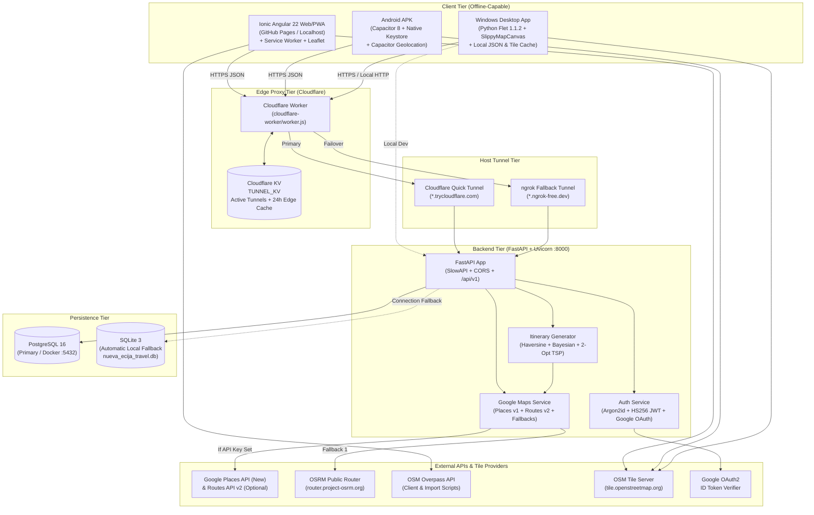

# 02 — System Architecture

## 1. High-Level Architecture

The Nueva Ecija Travel Itinerary system uses a **decoupled client-server architecture** augmented by an **edge reverse proxy** and **multi-tier offline fallbacks**. Both the Ionic Angular Web/Android client (`Project/`) and the Python Flet Desktop client (`desktop_client/`) communicate with the same FastAPI REST API (`backend/`) over HTTPS JSON, either directly (`http://127.0.0.1:8000/api/v1` in local development) or through the Cloudflare Worker edge proxy (`https://ne-itinerary-api.edselrenz0.workers.dev/api/v1`).

> Full standalone Mermaid diagrams are also maintained in [`diagrams/`](./diagrams/system-architecture.md).

---

## 2. Architectural Layers Breakdown

### 2.1 Frontend Architecture (`Project/` & `desktop_client/`)
- **Ionic Angular Web/PWA & Android (`Project/`)**:
  - **Bootstrap (`Project/src/main.ts`)**: Uses `provideZonelessChangeDetection()`, `IonicRouteStrategy`, `provideHttpClient(withInterceptors([authInterceptor]))`, `IonicStorageModule.forRoot()`, `withHashLocation()` (for GitHub Pages SPA routing compatibility), `PreloadAllModules`, and conditional `provideServiceWorker('ngsw-worker.js')` (enabled only in production non-Capacitor web builds).
  - **Leaflet Safety Guard**: `main.ts` defines a property guard on `window.L` to prevent destructive overwrites from stripping `MarkerClusterGroup` plugin methods.
  - **State Management**: Service-scoped RxJS `BehaviorSubject` observables (`AuthService.currentUser$`, `ConnectivityService.isHostOffline$`, `ItineraryService.itineraries$`, `ItineraryService.activeDraftItinerary$`, `FavoritesService.favorites$`, `GuestStorageService.isGuestMode$`, `RouteTrackingService.state$`). No NgRx or external store is used.
  - **Offline Resilience**: Bundles 2,673 OSM POIs in `Project/src/assets/data/osm_places.json`, curated places in `offline-places.data.ts`, and local guest storage via `@ionic/storage-angular` (IndexedDB/LocalStorage).
- **Flet Desktop Client (`desktop_client/`)**:
  - **Entry Point (`desktop_client/main.py`)**: Single-window Flet app with manual route dispatcher (`navigate_to()`), persistent 4-tab `BottomTabBar`, contextual `WorkflowHeader`, global `OfflineHostBanner`, and 2.8-second `SplashOverlay`.
  - **State Management**: Singleton manager instances (`SessionManager`, `ConnectivityService`, `FavoritesService`, `ItineraryService`, `PlaceService`) using observer callback lists (`add_listener` / `_notify`).
  - **Custom Slippy Map (`desktop_client/components/slippy_map_canvas.py`)**: Renders OpenStreetMap tiles with bundled pre-seeded tiles (`assets/tiles/`), runtime disk cache (`assets/tiles_cache/` or `storage/tile_cache/`), spatial indexing, marker clustering, and OSRM/Haversine polyline overlays.

### 2.2 Backend Architecture (`backend/`)
- **Framework**: FastAPI (`backend/app/main.py`) served by Uvicorn on port `8000`.
- **Layered Separation**:
  - `app/core/`: Configuration (`config.py`), SQLAlchemy engine & fallback (`database.py`), and proxy-aware SlowAPI rate limiter (`limiter.py`).
  - `app/api/v1/`: Thin route handlers (`auth.py`, `places.py`, `itineraries.py`) handling HTTP semantics, dependency injection, rate-limit decorators, and BOLA enforcement.
  - `app/schemas/`: Pydantic v2 request/response contracts with custom input normalization validators (e.g., forgiving `planned_time` and `place_id` coercion for Web/Desktop payload parity).
  - `app/services/`: Business services (`auth_service.py`, `google_maps_service.py`).
  - `app/algorithms/`: Pure algorithmic itinerary planner (`itinerary_generator.py`).
  - `app/models/`: SQLAlchemy 2.0 ORM entities (`entities.py`).

### 2.3 Database Architecture
- **Primary DBMS**: PostgreSQL 16 (`postgres:16-alpine` via `docker-compose.yml` / `docker-compose.prod.yml`), connected via `psycopg` v3 driver (`postgresql+psycopg://...`).
- **Automatic Local Fallback**: On startup (`backend/app/core/database.py`), SQLAlchemy tests the configured PostgreSQL connection with `connect_timeout=2`. If unreachable, it logs a warning and seamlessly falls back to `sqlite:///<repo_root>/nueva_ecija_travel.db`.
- **Portable Column Types**: `JsonType = JSON().with_variant(JSONB(), "postgresql")` allows identical ORM models and tests to run on both PostgreSQL (`JSONB`) and SQLite (`JSON`).
- **Schema Governance**: 4 sequential Alembic migrations (`0001`–`0004`) plus an idempotent startup auto-check `ensure_user_profile_columns(engine)`.

### 2.4 API & Edge Proxy Architecture
- **RESTful JSON API** prefixed under `/api/v1`:
  - `/api/v1/health` (liveness)
  - `/api/v1/auth/*` (7 routes)
  - `/api/v1/municipalities` & `/api/v1/places/*` (6 routes)
  - `/api/v1/itineraries/*` (13 routes)
- **Cloudflare Worker Reverse Proxy (`cloudflare-worker/worker.js`)**:
  - Solves dynamic tunnel URL rotation when hosting the backend on a local machine.
  - `scripts/start_server.ps1` / `scripts/run_daemon.py` POSTs active Cloudflare Tunnel & ngrok URLs to `/__sync_tunnel` (authenticated via `X-Admin-Sync-Key`), persisting them in Cloudflare KV (`ACTIVE_TUNNELS`).
  - Incoming API requests try `cfUrl` first, fail over to `ngrokUrl` on 5xx or ngrok offline headers, and serve 24-hour KV-cached JSON (`X-Edge-Cache: HIT`) for `GET /api/v1/places*` and `POST */compute-day-route` if both tunnels are down.

### 2.5 Authentication Architecture
- **Stateless Bearer JWT** (`HS256`): 30-minute access tokens + 7-day refresh tokens.
- **Web/Mobile Token Storage**: `SecureTokenStorageService` uses `capacitor-secure-storage-plugin` (Android Keystore) on native platforms and `localStorage`/`sessionStorage` (based on `rememberMe`) on web, with an in-memory synchronous cache for the HTTP interceptor.
- **Desktop Token Storage**: Plain JSON persisted in `desktop_client/storage/session.json` when `remember_me=True`.
- **Automatic Refresh Queue**: Both `auth.interceptor.ts` (RxJS `BehaviorSubject` gate) and `desktop_client/core/api_client.py` (`asyncio.Lock`) queue concurrent 401 requests during a single token refresh to prevent refresh storms.

### 2.6 Deployment Architecture
- **Web/PWA**: Built via GitHub Actions (`.github/workflows/deploy.yml`) and deployed to **GitHub Pages** (`https://edselrenz.github.io/Itinerary-App/`) with `.nojekyll` and `404.html` SPA fallback.
- **Android**: Built via `.github/workflows/release-builds.yml` (`ng build --configuration production --service-worker=false` → `npx cap sync android` → Gradle `assembleDebug` / `assembleRelease` with JDK 21).
- **Windows Desktop**: Built via `scripts/build_standalone_exe.py` (PyInstaller + cached Flet Flutter engine) and compiled into `NuevaEcijaTravel_Setup_v1.0.0.exe` via Inno Setup 6 (`installer/NuevaEcijaTravel.iss`).
- **Backend**: Runs either via multi-stage Docker (`backend/Dockerfile` + `docker-compose.prod.yml`) or locally via `start_server.bat` (`scripts/start_server.ps1`) with dual Cloudflare + ngrok tunnels.

---

## 3. Component Responsibilities Matrix

| Component | Purpose | Main Files | Inputs | Outputs | Key Dependencies |
|---|---|---|---|---|---|
| **Angular Core & Auth Layer** | Session lifecycle, JWT injection, 401 refresh queue, offline health telemetry, guest migration | `auth.service.ts`, `auth.interceptor.ts`, `connectivity.service.ts`, `secure-token-storage.service.ts`, `guest-migration.service.ts` | User credentials, HTTP requests, `localStorage`/Keystore | Bearer headers, `User` observables, offline banner state | `HttpClient`, `Capacitor`, `SecureStoragePlugin` |
| **Angular Discovery & Map Layer** | POI catalog, 16-category filtering, Leaflet clustering, live Overpass fetch, GPS tracking | `place.service.ts`, `osm-overpass.service.ts`, `route-tracking.service.ts`, `map.page.ts`, `itinerary-route-map.component.ts` | Map bounds, search query, category/municipality/price filters, GPS coordinates | Clustered markers, route polylines, ETA/off-route alerts | `leaflet`, `leaflet.markercluster`, `@capacitor/geolocation` |
| **Angular Itinerary & Export Layer** | Suggested wizard, custom multi-day builder, detail editor, offline clustering fallback, `.ics`/text export | `itinerary.service.ts`, `suggested-wizard.page.ts`, `custom-builder.page.ts`, `itinerary-detail.page.ts`, `itinerary-export.util.ts` | Trip parameters, stops, drag/reorder operations | Persisted or guest `Itinerary`, `.ics`/Markdown exports | `PlaceService`, `GuestStorageService`, `date.utils.ts` |
| **Flet Desktop Client** | Native Windows desktop UI mirroring all web workflows with offline map tiles | `desktop_client/main.py`, `core/api_client.py`, `components/slippy_map_canvas.py`, `views/*.py`, `services/*.py` | User interactions, local JSON storage, REST API responses | Rendered Flet views, local exports, tile cache | `flet`, `flet-map`, `httpx`, `pydantic` |
| **FastAPI Auth Module** | Registration, login, token refresh, profile update, Google OAuth verification, Apple 501 gate | `backend/app/api/v1/auth.py`, `backend/app/services/auth_service.py`, `backend/app/schemas/auth.py` | Credentials, JWTs, Google ID tokens | `TokenOut`, `UserOut`, HTTP 401/403/409/501 | `pwdlib[argon2]`, `pyjwt`, `google-auth`, `slowapi` |
| **FastAPI Places & GIS Module** | Municipality/POI queries, Google Places v1 search/details, photo proxy, Google Routes v2 + OSRM/Haversine routing | `backend/app/api/v1/places.py`, `backend/app/services/google_maps_service.py`, `backend/app/schemas/place.py` | Filters, bounding boxes, search queries, waypoints | `PaginatedPlacesOut`, `PlaceOut`, `RouteComputeResponse`, proxied JPEG bytes | `httpx`, `GeospatialCache`, `Place`, `Municipality` |
| **FastAPI Itinerary & Generator Module** | Deterministic suggested trip generation, BOLA-protected CRUD, stop reordering, day route persistence | `backend/app/api/v1/itineraries.py`, `backend/app/algorithms/itinerary_generator.py`, `backend/app/schemas/itinerary.py` | `SuggestedItineraryRequest`, `ItineraryCreate/Update`, `ItineraryReorderIn` | `ItineraryOut` with days, stops, assumptions, polylines | `GoogleMapsService`, SQLAlchemy ORM |
| **Cloudflare Edge Proxy** | Fixed HTTPS gateway, dynamic tunnel failover, 24h read/route edge cache | `cloudflare-worker/worker.js`, `cloudflare-worker/wrangler.toml` | Client HTTPS requests, admin `/__sync_tunnel` POST | Proxied upstream responses or `X-Edge-Cache: HIT` JSON | Cloudflare Workers runtime, `TUNNEL_KV` |
| **Operations & Data Pipeline** | DB setup, OSM Overpass scraping/import, curated seeding, backup/restore, APK/EXE packaging | `scripts/*.py`, `scripts/*.ps1`, `installer/NuevaEcijaTravel.iss` | Overpass API, local DB, source trees | Seeded DB, `osm_places.json`, backups, `.apk`, `Setup.exe` | `sqlalchemy`, `alembic`, `pyinstaller`, `gradle`, `ISCC` |

---

## 4. Diagram Cross-References

All six required architecture and flow diagrams are available in dedicated files under `documentation/diagrams/`:
1. [`diagrams/system-architecture.md`](./diagrams/system-architecture.md) — High-Level System Architecture & Deployment Topology
2. [`diagrams/component-architecture.md`](./diagrams/component-architecture.md) — Application Component Architecture (Angular, Flet, FastAPI)
3. [`diagrams/api-request-lifecycle.md`](./diagrams/api-request-lifecycle.md) — Frontend-to-Backend Communication & Request Lifecycle
4. [`diagrams/authentication-flow.md`](./diagrams/authentication-flow.md) — Authentication, Token Refresh & Guest Migration Flow
5. [`diagrams/database-erd.md`](./diagrams/database-erd.md) — Database Entity Relationship Diagram & Interaction Flow
6. [`diagrams/core-workflows.md`](./diagrams/core-workflows.md) — Suggested Itinerary Generation & External API Fallback Flow
