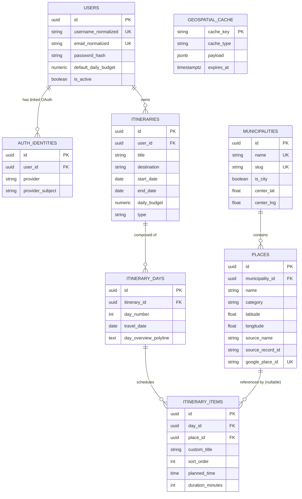

# 07 — Database Documentation

## 1. Database Overview

| Attribute | Verified Implementation |
|---|---|
| **Primary DBMS** | PostgreSQL 16 (`postgres:16-alpine` via `docker-compose.yml` / `docker-compose.prod.yml`) |
| **Local Fallback DBMS** | SQLite 3 (`<repo_root>/nueva_ecija_travel.db`), activated automatically if PostgreSQL connection fails within `connect_timeout=2` (`backend/app/core/database.py`) |
| **Driver & ORM** | SQLAlchemy `2.0+` with `psycopg[binary]>=3.2.0` (`postgresql+psycopg://...`) |
| **Portable JSON Type** | `JsonType = JSON().with_variant(JSONB(), "postgresql")` (`backend/app/models/entities.py`) |
| **Migration Tool** | Alembic `>=1.13.2` (`backend/alembic.ini`, `backend/alembic/env.py`) |
| **Applied Migrations** | 4 revisions: `0001_initial_schema` → `0002_google_places_and_routing` → `0003_widen_phone_column` → `0004_add_user_profile_fields` |
| **Startup Auto-Check** | `ensure_user_profile_columns(engine)` in `backend/app/core/database.py` verifies extended `users` columns exist on startup |

---

## 2. Complete Database Schema (8 Verified Tables)

### 2.1 `users`
Stores registered traveler accounts and profile preferences.

| Column | Data Type | PK | FK | Nullable | Default | Description |
|---|---|---|---|---|---|---|
| `id` | `UUID` | Yes | — | No | `uuid.uuid4` | Primary traveler identifier |
| `first_name` | `VARCHAR(80)` | No | — | No | — | Given name |
| `last_name` | `VARCHAR(80)` | No | — | No | — | Surname |
| `username_normalized` | `VARCHAR(50)` | No | — | No | — | Lowercased unique username (`ix_users_username_normalized`, UNIQUE) |
| `email_normalized` | `VARCHAR(255)` | No | — | No | — | Lowercased unique email (`ix_users_email_normalized`, UNIQUE) |
| `password_hash` | `VARCHAR(255)` | No | — | Yes | `NULL` | Argon2id hash (`NULL` for OAuth-only accounts) |
| `middle_initial` | `VARCHAR(16)` | No | — | Yes | `NULL` | Optional middle initial (added in `0004`) |
| `phone_number` | `VARCHAR(40)` | No | — | Yes | `NULL` | Contact phone number (added in `0004`) |
| `birthday` | `VARCHAR(40)` | No | — | Yes | `NULL` | Display/ISO birthday string (added in `0004`) |
| `gender` | `VARCHAR(32)` | No | — | Yes | `NULL` | Gender preference (added in `0004`) |
| `avatar_url` | `TEXT` | No | — | Yes | `NULL` | Relative asset path or data URI (added in `0004`) |
| `default_daily_budget` | `NUMERIC(10,2)` | No | — | Yes | `3000.0` | Default PHP daily budget (added in `0004`) |
| `is_active` | `BOOLEAN` | No | — | No | `true` | Soft deactivation flag |
| `created_at` | `TIMESTAMPTZ` | No | — | No | `now()` | Account creation UTC timestamp |
| `updated_at` | `TIMESTAMPTZ` | No | — | No | `now()` | Last modification UTC timestamp |

### 2.2 `auth_identities`
Links external OAuth provider subjects (Google) to `users`.

| Column | Data Type | PK | FK | Nullable | Default | Description |
|---|---|---|---|---|---|---|
| `id` | `UUID` | Yes | — | No | `uuid.uuid4` | Primary key |
| `user_id` | `UUID` | No | `users.id` (`ON DELETE CASCADE`) | No | — | Linked traveler (`ix_auth_identities_user_id`) |
| `provider` | `VARCHAR(32)` | No | — | No | — | Provider name (e.g., `"google"`) |
| `provider_subject` | `VARCHAR(255)` | No | — | No | — | Immutable provider `sub` claim |
| `provider_email` | `VARCHAR(255)` | No | — | Yes | `NULL` | Provider email at link time |
| `created_at` | `TIMESTAMPTZ` | No | — | No | `now()` | Link timestamp |

- **Unique Constraint**: `uq_provider_subject (provider, provider_subject)`.

### 2.3 `municipalities`
Cities and municipalities within Nueva Ecija province.

| Column | Data Type | PK | FK | Nullable | Default | Description |
|---|---|---|---|---|---|---|
| `id` | `UUID` | Yes | — | No | `uuid.uuid4` | Primary key |
| `name` | `VARCHAR(100)` | No | — | No | — | Unique LGU name (e.g., `Cabanatuan City`) |
| `slug` | `VARCHAR(100)` | No | — | No | — | URL-friendly unique slug (`ix_municipalities_slug`, UNIQUE) |
| `is_city` | `BOOLEAN` | No | — | No | `false` | `true` for component cities, `false` for municipalities |
| `center_lat` | `FLOAT` | No | — | No | — | Centroid latitude |
| `center_lng` | `FLOAT` | No | — | No | — | Centroid longitude |
| `boundary_geojson` | `JSONB` / `JSON` | No | — | Yes | `NULL` | Optional GeoJSON polygon |

### 2.4 `places`
Points of Interest (POIs) imported from OpenStreetMap, curated seeds, or upserted from Google Places API (New).

| Column | Data Type | PK | FK | Nullable | Default | Description |
|---|---|---|---|---|---|---|
| `id` | `UUID` | Yes | — | No | `uuid.uuid4` | Primary key |
| `name` | `VARCHAR(200)` | No | — | No | — | Venue name (`ix_places_name`) |
| `category` | `VARCHAR(64)` | No | — | No | — | One of 16 canonical categories (`ix_places_category`) |
| `latitude` / `longitude` | `FLOAT` | No | — | No | — | WGS84 coordinates (`ix_places_lat_lng`, `ix_places_lat_lng_active`) |
| `municipality_id` | `UUID` | No | `municipalities.id` (`ON DELETE SET NULL`) | Yes | `NULL` | Nearest/assigned LGU (`ix_places_municipality_id`) |
| `address_text` | `VARCHAR(255)` | No | — | Yes | `NULL` | Formatted street/barangay address |
| `description` | `TEXT` | No | — | Yes | `NULL` | Venue description |
| `phone` | `VARCHAR(255)` | No | — | Yes | `NULL` | Contact number (widened from 64 in `0003`) |
| `website` | `VARCHAR(255)` | No | — | Yes | `NULL` | Official URL |
| `opening_hours` | `VARCHAR(255)` | No | — | Yes | `NULL` | OSM-style opening hours string |
| `estimated_cost_min` / `max` | `NUMERIC(10,2)` | No | — | Yes | `NULL` | Verified cost range (`NULL` = unverified, not ₱0) |
| `cost_currency` | `VARCHAR(3)` | No | — | No | `'PHP'` | ISO currency code |
| `image_url` / `image_license` | `VARCHAR(500)` / `255` | No | — | Yes | `NULL` | Image URL/proxy path & license attribution |
| `source_name` | `VARCHAR(64)` | No | — | No | `'OpenStreetMap'` | Provenance (`OpenStreetMap`, `CuratedNuevaEcijaMVP`, `google_places`) |
| `source_record_id` | `VARCHAR(128)` | No | — | No | — | Upstream record ID (`uq_place_source_record`) |
| `source_url` | `VARCHAR(500)` | No | — | Yes | `NULL` | Provenance link |
| `imported_at` / `verified_at` | `TIMESTAMPTZ` | No | — | No / Yes | `now()` / `NULL` | Import & verification timestamps |
| `is_featured` / `is_active` | `BOOLEAN` | No | — | No | `false` / `true` | Discovery flags (indexed) |
| `tags` | `JSONB` / `JSON` | No | — | No | `[]` | Searchable tag list |
| `google_place_id` | `VARCHAR(128)` | No | — | Yes | `NULL` | Unique Google Place ID (`ix_places_google_place_id`, UNIQUE, added in `0002`) |
| `google_types` | `JSONB` / `JSON` | No | — | No | `[]` | Raw Google place types (`0002`) |
| `editorial_summary` | `TEXT` | No | — | Yes | `NULL` | Google editorial overview (`0002`) |
| `regular_opening_hours` | `JSONB` / `JSON` | No | — | Yes | `NULL` | Structured Google periods & weekday descriptions (`0002`) |
| `rating` / `user_rating_count` | `FLOAT` / `INTEGER` | No | — | Yes | `NULL` | Star rating (`ix_places_rating`) & review count (`0002`) |
| `price_level` | `INTEGER` | No | — | Yes | `NULL` | `0..4` Google price tier (`0002`) |
| `photos` / `reviews` | `JSONB` / `JSON` | No | — | No | `[]` | Normalized Google photo & review arrays (`0002`) |
| `business_status` | `VARCHAR(40)` | No | — | Yes | `NULL` | e.g., `OPERATIONAL` (`0002`) |
| `google_maps_uri` | `VARCHAR(500)` | No | — | Yes | `NULL` | Canonical Google Maps link (`0002`) |
| `details_cached_at` | `TIMESTAMPTZ` | No | — | Yes | `NULL` | Timestamp of last rich details fetch (`0002`) |

### 2.5 `itineraries`
Multi-day travel plans owned by a user.

| Column | Data Type | PK | FK | Nullable | Default | Description |
|---|---|---|---|---|---|---|
| `id` | `UUID` | Yes | — | No | `uuid.uuid4` | Primary key |
| `user_id` | `UUID` | No | `users.id` (`ON DELETE CASCADE`) | No | — | Owner (`ix_itineraries_user_id`) |
| `title` | `VARCHAR(160)` | No | — | No | — | Trip title |
| `destination` | `VARCHAR(120)` | No | — | No | — | Target municipality or `"Nueva Ecija"` |
| `start_date` / `end_date` | `DATE` | No | — | No | — | Inclusive trip dates |
| `daily_budget` | `NUMERIC(10,2)` | No | — | No | — | PHP daily budget target |
| `preferences` | `JSONB` / `JSON` | No | — | No | `[]` | Selected interest keywords |
| `type` | `VARCHAR(20)` | No | — | No | — | `'suggested'` or `'custom'` |
| `assumptions` | `JSONB` / `JSON` | No | — | No | `[]` | Transparent planning/pricing notes |
| `created_at` / `updated_at` | `TIMESTAMPTZ` | No | — | No | `now()` | Audit timestamps |

### 2.6 `itinerary_days`
Individual calendar days within an itinerary.

| Column | Data Type | PK | FK | Nullable | Default | Description |
|---|---|---|---|---|---|---|
| `id` | `UUID` | Yes | — | No | `uuid.uuid4` | Primary key |
| `itinerary_id` | `UUID` | No | `itineraries.id` (`ON DELETE CASCADE`) | No | — | Parent trip (`ix_itinerary_days_itinerary_id`) |
| `day_number` | `INTEGER` | No | — | No | — | 1-indexed sequence (`uq_itinerary_day_num (itinerary_id, day_number)`) |
| `travel_date` | `DATE` | No | — | No | — | Calendar date |
| `title` | `VARCHAR(120)` | No | — | Yes | `NULL` | Optional day heading |
| `day_overview_polyline` | `TEXT` | No | — | Yes | `NULL` | Encoded polyline for the full day (`0002`) |
| `total_distance_meters` | `INTEGER` | No | — | Yes | `NULL` | Sum of road distances (`0002`) |
| `total_travel_duration_seconds` | `INTEGER` | No | — | Yes | `NULL` | Sum of travel durations (`0002`) |
| `route_legs` | `JSONB` / `JSON` | No | — | No | `[]` | Turn-by-turn leg metadata (`0002`) |

### 2.7 `itinerary_items`
Chronological stops (linked `Place` or custom off-grid stop) on a day.

| Column | Data Type | PK | FK | Nullable | Default | Description |
|---|---|---|---|---|---|---|
| `id` | `UUID` | Yes | — | No | `uuid.uuid4` | Primary key |
| `day_id` | `UUID` | No | `itinerary_days.id` (`ON DELETE CASCADE`) | No | — | Parent day (`ix_itinerary_items_day_id`) |
| `place_id` | `UUID` | No | `places.id` (`ON DELETE SET NULL`) | Yes | `NULL` | Linked catalog POI |
| `custom_title` | `VARCHAR(200)` | No | — | Yes | `NULL` | Title for custom stop |
| `custom_lat` / `custom_lng` | `FLOAT` | No | — | Yes | `NULL` | Coordinates for custom stop |
| `sort_order` | `INTEGER` | No | — | No | `1` | 1-indexed display order within day |
| `planned_time` | `TIME` | No | — | Yes | `NULL` | Scheduled arrival time |
| `duration_minutes` | `INTEGER` | No | — | No | `90` | Planned stay length |
| `notes` | `TEXT` | No | — | Yes | `NULL` | Traveler or algorithm notes |
| `estimated_cost_min` / `max` | `NUMERIC(10,2)` | No | — | Yes | `NULL` | Per-stop cost range |
| `google_place_id` | `VARCHAR(128)` | No | — | Yes | `NULL` | Google Place reference (`ix_itinerary_items_google_place_id`, `0002`) |
| `travel_mode_from_prev` | `VARCHAR(20)` | No | — | Yes | `NULL` | `DRIVE`, `WALK`, etc. (`0002`) |
| `travel_distance_meters` | `INTEGER` | No | — | Yes | `NULL` | Leg distance from previous stop (`0002`) |
| `travel_duration_seconds` | `INTEGER` | No | — | Yes | `NULL` | Leg duration from previous stop (`0002`) |
| `route_polyline_from_prev` | `TEXT` | No | — | Yes | `NULL` | Encoded polyline from previous stop (`0002`) |
| `created_at` / `updated_at` | `TIMESTAMPTZ` | No | — | No | `now()` | Audit timestamps |

### 2.8 `geospatial_cache`
TTL cache for external Google Places & Routes / OSRM responses (added in `0002`).

| Column | Data Type | PK | FK | Nullable | Default | Description |
|---|---|---|---|---|---|---|
| `cache_key` | `VARCHAR(255)` | Yes | — | No | — | Deterministic SHA-256 / coordinate cache key |
| `cache_type` | `VARCHAR(32)` | No | — | No | — | `'places_search'`, `'places_nearby'`, `'place_details'`, `'route'` (`ix_geospatial_cache_cache_type`) |
| `payload` | `JSONB` / `JSON` | No | — | No | — | Cached normalized response payload |
| `created_at` | `TIMESTAMPTZ` | No | — | No | `now()` | Cache insertion time |
| `expires_at` | `TIMESTAMPTZ` | No | — | No | — | Expiration UTC timestamp (`ix_geospatial_cache_expires_at`) |

---

## 3. Entity Relationship Diagram



---

## 4. Database Operations & Management Guide

### ORM Operations Mapping
- **Create**: `register_user()`, `create_itinerary()`, `persist_generated_itinerary()`, `add_itinerary_day()`, `add_itinerary_item()`, `upsert_google_place_to_db()`.
- **Retrieve**: `list_municipalities()`, `list_places()` (with `joinedload(Place.municipality)`), `get_eager_itinerary_stmt()` (3-level `selectinload`: `Itinerary.days → ItineraryDay.items → ItineraryItem.place`).
- **Update**: `update_user_profile()`, `update_itinerary()` (replaces `days` via `itinerary.days.clear()` + `cascade="all, delete-orphan"`), `update_itinerary_item()`, `reorder_itinerary_items()`, `compute_and_save_day_route()`.
- **Delete**: `delete_itinerary()` (cascades days & items), `delete_itinerary_item()` (deletes item and re-compacts `sort_order`).
- **Transactions**: Each request uses one SQLAlchemy session (`get_db()`); explicit `db.flush()` assigns parent UUIDs before child inserts, followed by a single `db.commit()` (and `db.rollback()` on `IntegrityError` or cache write failures).

### Practical DBA Commands
```bash
# 1. Start PostgreSQL 16 via Docker Compose
docker compose up -d

# 2. Verify connection, run Alembic migrations, and seed curated places automatically
python scripts/setup_postgres.py

# 3. Run Alembic migrations manually
cd backend
alembic upgrade head
alembic current
alembic history

# 4. Create a new migration after editing backend/app/models/entities.py
alembic revision --autogenerate -m "describe_schema_change"

# 5. Seed featured places & import OSM data
python scripts/seed_featured_places.py
python scripts/fetch_osm_places.py
python scripts/import_osm.py data/raw/nueva_ecija_osm.json --dry-run
python scripts/import_osm.py data/raw/nueva_ecija_osm.json

# 6. Backup & restore (PostgreSQL or SQLite)
python scripts/db_backup_restore.py backup
python scripts/db_backup_restore.py restore backups/<backup_file>
```
