# 07 — Database Documentation

## 1. Database Overview

| Attribute | Verified Implementation |
|---|---|
| **Primary DBMS** | PostgreSQL 16 (`postgres:16-alpine` via `docker-compose.yml` / `docker-compose.prod.yml`) |
| **Local Fallback DBMS** | SQLite 3 (`<repo_root>/nueva_ecija_travel.db`), activated automatically if PostgreSQL connection fails within `connect_timeout=2` (`backend/app/core/database.py`) |
| **Driver & ORM** | SQLAlchemy `2.0+` with `psycopg[binary]>=3.2.0` (`postgresql+psycopg://...`) |
| **Portable JSON Type** | `JsonType = JSON().with_variant(JSONB(), "postgresql")` (`backend/app/models/entities.py`) |
| **Migration Tool** | Alembic `>=1.13.2` (`backend/alembic.ini`, `backend/alembic/env.py`) |
| **Applied Migrations** | 4 revisions: `0001_initial_schema` → `0002_google_places_and_routing` → `0003_widen_phone_column` → `0004_add_user_profile_fields` |
| **Total Schema Size** | **8 ORM tables, 109 columns** (`backend/app/models/entities.py`) |
| **Startup Auto-Check** | `ensure_user_profile_columns(engine)` in `backend/app/core/database.py` verifies extended `users` columns exist on startup |

> **Verified ORM-vs-Alembic Drift**: `Place.__table_args__` in `backend/app/models/entities.py` declares a composite index `ix_places_lat_lng_active (latitude, longitude, is_active)`, which is created automatically on SQLite via `Base.metadata.create_all`, **but is not present in Alembic migrations `0001`–`0004`** for PostgreSQL.

---

## 2. Complete Database Schema (8 Tables, 109 Columns — 1:1 Verified Against `entities.py`)

### 2.1 `users` (15 columns)
Stores registered traveler accounts and extended profile preferences.

| Column | Data Type | PK | FK | Nullable | Default | Description |
|---|---|---|---|---|---|---|
| `id` | `UUID` | Yes | — | No | `uuid.uuid4` | Primary traveler identifier |
| `first_name` | `VARCHAR(80)` | No | — | No | — | Given name |
| `last_name` | `VARCHAR(80)` | No | — | No | — | Surname |
| `username_normalized` | `VARCHAR(50)` | No | — | No | — | Lowercased unique username (`ix_users_username_normalized`, UNIQUE) |
| `email_normalized` | `VARCHAR(255)` | No | — | No | — | Lowercased unique email (`ix_users_email_normalized`, UNIQUE) |
| `password_hash` | `VARCHAR(255)` | No | — | Yes | `NULL` | Argon2id hash (`NULL` for OAuth-only accounts) |
| `middle_initial` | `VARCHAR(16)` | No | — | Yes | `NULL` | Optional middle initial (added in migration `0004`) |
| `phone_number` | `VARCHAR(40)` | No | — | Yes | `NULL` | Contact phone number (added in migration `0004`) |
| `birthday` | `VARCHAR(40)` | No | — | Yes | `NULL` | Birthday string (added in migration `0004`) |
| `gender` | `VARCHAR(32)` | No | — | Yes | `NULL` | Gender preference (added in migration `0004`) |
| `avatar_url` | `TEXT` | No | — | Yes | `NULL` | Relative asset path or data URI (added in migration `0004`) |
| `default_daily_budget` | `NUMERIC(10,2)` | No | — | Yes | `3000.0` | Default PHP daily budget (added in migration `0004`) |
| `is_active` | `BOOLEAN` | No | — | No | `true` | Soft deactivation flag |
| `created_at` | `TIMESTAMPTZ` | No | — | No | `utcnow` / `now()` | Account creation UTC timestamp |
| `updated_at` | `TIMESTAMPTZ` | No | — | No | `utcnow` / `now()` | Last modification UTC timestamp (`onupdate=utcnow`) |

- **Indexes & Constraints**: `ix_users_username_normalized` (UNIQUE), `ix_users_email_normalized` (UNIQUE).
- **ORM Relationships**: `identities` (`1:N` → `auth_identities`, `cascade="all, delete-orphan"`), `itineraries` (`1:N` → `itineraries`, `cascade="all, delete-orphan"`).

---

### 2.2 `auth_identities` (6 columns)
Links external OAuth provider subjects (Google) to `users`.

| Column | Data Type | PK | FK | Nullable | Default | Description |
|---|---|---|---|---|---|---|
| `id` | `UUID` | Yes | — | No | `uuid.uuid4` | Primary key |
| `user_id` | `UUID` | No | `users.id` (`ON DELETE CASCADE`) | No | — | Linked traveler (`ix_auth_identities_user_id`) |
| `provider` | `VARCHAR(32)` | No | — | No | — | Provider name (e.g., `"google"`) |
| `provider_subject` | `VARCHAR(255)` | No | — | No | — | Immutable provider `sub` claim |
| `provider_email` | `VARCHAR(255)` | No | — | Yes | `NULL` | Provider email captured at link time |
| `created_at` | `TIMESTAMPTZ` | No | — | No | `utcnow` / `now()` | Link creation UTC timestamp |

- **Indexes & Constraints**: `uq_provider_subject (provider, provider_subject)` (UNIQUE), `ix_auth_identities_user_id`.

---

### 2.3 `municipalities` (7 columns)
Cities and municipalities within Nueva Ecija province.

| Column | Data Type | PK | FK | Nullable | Default | Description |
|---|---|---|---|---|---|---|
| `id` | `UUID` | Yes | — | No | `uuid.uuid4` | Primary key |
| `name` | `VARCHAR(100)` | No | — | No | — | Unique LGU name (e.g., `Cabanatuan City`) |
| `slug` | `VARCHAR(100)` | No | — | No | — | URL-friendly unique slug (`ix_municipalities_slug`, UNIQUE) |
| `is_city` | `BOOLEAN` | No | — | No | `false` | `true` for component cities, `false` for municipalities |
| `center_lat` | `FLOAT` | No | — | No | — | Centroid latitude (WGS84) |
| `center_lng` | `FLOAT` | No | — | No | — | Centroid longitude (WGS84) |
| `boundary_geojson` | `JSONB` / `JSON` | No | — | Yes | `NULL` | Optional GeoJSON boundary polygon |

- **Indexes & Constraints**: Unique constraint on `name`, `ix_municipalities_slug` (UNIQUE).
- **ORM Relationships**: `places` (`1:N` → `places`).

---

### 2.4 `places` (36 columns)
Points of Interest (POIs) within Nueva Ecija imported from OpenStreetMap, curated seeds, or upserted from Google Places API (New).

| Column | Data Type | PK | FK | Nullable | Default | Description |
|---|---|---|---|---|---|---|
| `id` | `UUID` | Yes | — | No | `uuid.uuid4` | Primary key |
| `name` | `VARCHAR(200)` | No | — | No | — | Venue name (`ix_places_name`) |
| `category` | `VARCHAR(64)` | No | — | No | — | One of 16 canonical categories (`ix_places_category`) |
| `latitude` | `FLOAT` | No | — | No | — | WGS84 latitude |
| `longitude` | `FLOAT` | No | — | No | — | WGS84 longitude |
| `municipality_id` | `UUID` | No | `municipalities.id` (`ON DELETE SET NULL`) | Yes | `NULL` | Assigned LGU (`ix_places_municipality_id`) |
| `address_text` | `VARCHAR(255)` | No | — | Yes | `NULL` | Formatted street/barangay address |
| `description` | `TEXT` | No | — | Yes | `NULL` | Venue description |
| `phone` | `VARCHAR(255)` | No | — | Yes | `NULL` | Contact number (widened from `VARCHAR(64)` in migration `0003`) |
| `website` | `VARCHAR(255)` | No | — | Yes | `NULL` | Official venue URL |
| `opening_hours` | `VARCHAR(255)` | No | — | Yes | `NULL` | OSM-style opening hours string |
| `estimated_cost_min` | `NUMERIC(10,2)` | No | — | Yes | `NULL` | Minimum estimated cost (`NULL` = unverified, not ₱0) |
| `estimated_cost_max` | `NUMERIC(10,2)` | No | — | Yes | `NULL` | Maximum estimated cost |
| `cost_currency` | `VARCHAR(3)` | No | — | No | `'PHP'` | ISO 4217 currency code |
| `image_url` | `VARCHAR(500)` | No | — | Yes | `NULL` | Hero image URL or `/api/v1/places/photos/...` proxy path |
| `image_license` | `VARCHAR(255)` | No | — | Yes | `NULL` | Image copyright/license attribution |
| `source_name` | `VARCHAR(64)` | No | — | No | `'OpenStreetMap'` | Provenance (`OpenStreetMap`, `CuratedNuevaEcijaMVP`, `google_places`) |
| `source_record_id` | `VARCHAR(128)` | No | — | No | — | Upstream record identifier |
| `source_url` | `VARCHAR(500)` | No | — | Yes | `NULL` | Upstream source link |
| `imported_at` | `TIMESTAMPTZ` | No | — | No | `utcnow` / `now()` | Record import UTC timestamp |
| `verified_at` | `TIMESTAMPTZ` | No | — | Yes | `NULL` | Last verification UTC timestamp |
| `is_featured` | `BOOLEAN` | No | — | No | `false` | Featured discovery flag (`ix_places_is_featured`) |
| `is_active` | `BOOLEAN` | No | — | No | `true` | Active catalog visibility flag (`ix_places_is_active`) |
| `tags` | `JSONB` / `JSON` | No | — | No | `[]` | Searchable tag list |
| `google_place_id` | `VARCHAR(128)` | No | — | Yes | `NULL` | Unique Google Place ID (`ix_places_google_place_id`, UNIQUE, migration `0002`) |
| `google_types` | `JSONB` / `JSON` | No | — | No | `[]` | Raw Google Places types array (migration `0002`) |
| `editorial_summary` | `TEXT` | No | — | Yes | `NULL` | Google editorial summary text (migration `0002`) |
| `regular_opening_hours` | `JSONB` / `JSON` | No | — | Yes | `NULL` | Structured Google periods & weekday descriptions (migration `0002`) |
| `rating` | `FLOAT` | No | — | Yes | `NULL` | Average user star rating (`ix_places_rating`, migration `0002`) |
| `user_rating_count` | `INTEGER` | No | — | Yes | `NULL` | Total user rating count (migration `0002`) |
| `price_level` | `INTEGER` | No | — | Yes | `NULL` | Normalized Google price tier `0..4` (migration `0002`) |
| `photos` | `JSONB` / `JSON` | No | — | No | `[]` | Normalized Google photo metadata array (migration `0002`) |
| `reviews` | `JSONB` / `JSON` | No | — | No | `[]` | Normalized Google review objects array (migration `0002`) |
| `business_status` | `VARCHAR(40)` | No | — | Yes | `NULL` | Operational status e.g. `OPERATIONAL` (migration `0002`) |
| `google_maps_uri` | `VARCHAR(500)` | No | — | Yes | `NULL` | Canonical Google Maps deep link (migration `0002`) |
| `details_cached_at` | `TIMESTAMPTZ` | No | — | Yes | `NULL` | Timestamp of last rich details refresh (migration `0002`) |

- **Unique Constraints**: `uq_place_source_record (source_name, source_record_id)`, `ix_places_google_place_id (google_place_id)`.
- **Indexes**: `ix_places_name`, `ix_places_category`, `ix_places_municipality_id`, `ix_places_is_featured`, `ix_places_is_active`, `ix_places_rating`, `ix_places_lat_lng (latitude, longitude)`, `ix_places_lat_lng_active (latitude, longitude, is_active)` *(ORM-only; not yet in Alembic)*.

---

### 2.5 `itineraries` (12 columns)
Saved multi-day travel itineraries owned by an authenticated user.

| Column | Data Type | PK | FK | Nullable | Default | Description |
|---|---|---|---|---|---|---|
| `id` | `UUID` | Yes | — | No | `uuid.uuid4` | Primary key |
| `user_id` | `UUID` | No | `users.id` (`ON DELETE CASCADE`) | No | — | Owner (`ix_itineraries_user_id`) |
| `title` | `VARCHAR(160)` | No | — | No | — | Trip title |
| `destination` | `VARCHAR(120)` | No | — | No | — | Target municipality or `"Nueva Ecija"` |
| `start_date` | `DATE` | No | — | No | — | Inclusive start date |
| `end_date` | `DATE` | No | — | No | — | Inclusive end date |
| `daily_budget` | `NUMERIC(10,2)` | No | — | No | — | Target daily budget in PHP |
| `preferences` | `JSONB` / `JSON` | No | — | No | `[]` | Selected interest keywords |
| `type` | `VARCHAR(20)` | No | — | No | — | `'suggested'` or `'custom'` |
| `assumptions` | `JSONB` / `JSON` | No | — | No | `[]` | Transparent pacing/pricing disclosures |
| `created_at` | `TIMESTAMPTZ` | No | — | No | `utcnow` / `now()` | Creation UTC timestamp |
| `updated_at` | `TIMESTAMPTZ` | No | — | No | `utcnow` / `now()` | Last modification UTC timestamp (`onupdate=utcnow`) |

- **Indexes**: `ix_itineraries_user_id`.
- **ORM Relationships**: `user` (`N:1` → `users`), `days` (`1:N` → `itinerary_days`, ordered by `day_number`, `cascade="all, delete-orphan"`).

---

### 2.6 `itinerary_days` (9 columns)
Individual calendar days within an itinerary.

| Column | Data Type | PK | FK | Nullable | Default | Description |
|---|---|---|---|---|---|---|
| `id` | `UUID` | Yes | — | No | `uuid.uuid4` | Primary key |
| `itinerary_id` | `UUID` | No | `itineraries.id` (`ON DELETE CASCADE`) | No | — | Parent itinerary (`ix_itinerary_days_itinerary_id`) |
| `day_number` | `INTEGER` | No | — | No | — | 1-indexed day sequence |
| `travel_date` | `DATE` | No | — | No | — | Calendar date of this day |
| `title` | `VARCHAR(120)` | No | — | Yes | `NULL` | Optional day heading |
| `day_overview_polyline` | `TEXT` | No | — | Yes | `NULL` | Encoded polyline spanning all stops (migration `0002`) |
| `total_distance_meters` | `INTEGER` | No | — | Yes | `NULL` | Total road distance in meters (migration `0002`) |
| `total_travel_duration_seconds` | `INTEGER` | No | — | Yes | `NULL` | Total travel duration in seconds (migration `0002`) |
| `route_legs` | `JSONB` / `JSON` | No | — | No | `[]` | Turn-by-turn leg metadata array (migration `0002`) |

- **Unique Constraints & Indexes**: `uq_itinerary_day_num (itinerary_id, day_number)`, `ix_itinerary_days_itinerary_id`.
- **ORM Relationships**: `itinerary` (`N:1` → `itineraries`), `items` (`1:N` → `itinerary_items`, ordered by `sort_order`, `cascade="all, delete-orphan"`).

---

### 2.7 `itinerary_items` (19 columns)
Chronological stops (linked `Place` or custom off-grid stop) scheduled on an itinerary day.

| Column | Data Type | PK | FK | Nullable | Default | Description |
|---|---|---|---|---|---|---|
| `id` | `UUID` | Yes | — | No | `uuid.uuid4` | Primary key |
| `day_id` | `UUID` | No | `itinerary_days.id` (`ON DELETE CASCADE`) | No | — | Parent day (`ix_itinerary_items_day_id`) |
| `place_id` | `UUID` | No | `places.id` (`ON DELETE SET NULL`) | Yes | `NULL` | Linked catalog POI |
| `custom_title` | `VARCHAR(200)` | No | — | Yes | `NULL` | Custom stop title (when not linked to a POI) |
| `custom_lat` | `FLOAT` | No | — | Yes | `NULL` | Custom stop latitude |
| `custom_lng` | `FLOAT` | No | — | Yes | `NULL` | Custom stop longitude |
| `sort_order` | `INTEGER` | No | — | No | `1` | 1-indexed order within the day |
| `planned_time` | `TIME` | No | — | Yes | `NULL` | Scheduled arrival time |
| `duration_minutes` | `INTEGER` | No | — | No | `90` | Planned visit duration in minutes |
| `notes` | `TEXT` | No | — | Yes | `NULL` | Traveler or generator notes |
| `estimated_cost_min` | `NUMERIC(10,2)` | No | — | Yes | `NULL` | Minimum estimated stop cost |
| `estimated_cost_max` | `NUMERIC(10,2)` | No | — | Yes | `NULL` | Maximum estimated stop cost |
| `google_place_id` | `VARCHAR(128)` | No | — | Yes | `NULL` | Google Place reference (`ix_itinerary_items_google_place_id`, migration `0002`) |
| `travel_mode_from_prev` | `VARCHAR(20)` | No | — | Yes | `NULL` | Travel mode from prior stop (`DRIVE`, `WALK`, etc., migration `0002`) |
| `travel_distance_meters` | `INTEGER` | No | — | Yes | `NULL` | Leg distance from prior stop in meters (migration `0002`) |
| `travel_duration_seconds` | `INTEGER` | No | — | Yes | `NULL` | Leg travel duration from prior stop in seconds (migration `0002`) |
| `route_polyline_from_prev` | `TEXT` | No | — | Yes | `NULL` | Encoded leg polyline from prior stop (migration `0002`) |
| `created_at` | `TIMESTAMPTZ` | No | — | No | `utcnow` / `now()` | Creation UTC timestamp |
| `updated_at` | `TIMESTAMPTZ` | No | — | No | `utcnow` / `now()` | Last modification UTC timestamp (`onupdate=utcnow`) |

- **Indexes**: `ix_itinerary_items_day_id`, `ix_itinerary_items_google_place_id`.

---

### 2.8 `geospatial_cache` (5 columns)
TTL cache for external Google Places Search, Place Details, and Google Routes / OSRM responses (added in migration `0002`).

| Column | Data Type | PK | FK | Nullable | Default | Description |
|---|---|---|---|---|---|---|
| `cache_key` | `VARCHAR(255)` | Yes | — | No | — | Deterministic SHA-256 or coordinate cache key |
| `cache_type` | `VARCHAR(32)` | No | — | No | — | `'places_search'`, `'places_nearby'`, `'place_details'`, or `'route'` (`ix_geospatial_cache_cache_type`) |
| `payload` | `JSONB` / `JSON` | No | — | No | — | Cached normalized JSON response payload |
| `created_at` | `TIMESTAMPTZ` | No | — | No | `utcnow` / `now()` | Cache insertion UTC timestamp |
| `expires_at` | `TIMESTAMPTZ` | No | — | No | — | Expiration UTC timestamp (`ix_geospatial_cache_expires_at`) |

- **Indexes**: `ix_geospatial_cache_cache_type`, `ix_geospatial_cache_expires_at`.

---

## 3. Complete Entity Relationship Diagram (All 8 Tables, All 109 Columns)

Every table and column below matches Section 2 and `backend/app/models/entities.py` **1-to-1**.

```mermaid
erDiagram
    USERS ||--o{ AUTH_IDENTITIES : "has linked OAuth (CASCADE)"
    USERS ||--o{ ITINERARIES : "owns (CASCADE)"
    MUNICIPALITIES ||--o{ PLACES : "contains (SET NULL)"
    ITINERARIES ||--o{ ITINERARY_DAYS : "composed of (CASCADE)"
    ITINERARY_DAYS ||--o{ ITINERARY_ITEMS : "schedules (CASCADE)"
    PLACES ||--o{ ITINERARY_ITEMS : "referenced by (SET NULL)"

    USERS {
        uuid id PK
        varchar first_name
        varchar last_name
        varchar username_normalized UK
        varchar email_normalized UK
        varchar password_hash
        varchar middle_initial
        varchar phone_number
        varchar birthday
        varchar gender
        text avatar_url
        numeric default_daily_budget
        boolean is_active
        timestamptz created_at
        timestamptz updated_at
    }

    AUTH_IDENTITIES {
        uuid id PK
        uuid user_id FK
        varchar provider
        varchar provider_subject
        varchar provider_email
        timestamptz created_at
    }

    MUNICIPALITIES {
        uuid id PK
        varchar name UK
        varchar slug UK
        boolean is_city
        float center_lat
        float center_lng
        jsonb boundary_geojson
    }

    PLACES {
        uuid id PK
        varchar name
        varchar category
        float latitude
        float longitude
        uuid municipality_id FK
        varchar address_text
        text description
        varchar phone
        varchar website
        varchar opening_hours
        numeric estimated_cost_min
        numeric estimated_cost_max
        varchar cost_currency
        varchar image_url
        varchar image_license
        varchar source_name
        varchar source_record_id
        varchar source_url
        timestamptz imported_at
        timestamptz verified_at
        boolean is_featured
        boolean is_active
        jsonb tags
        varchar google_place_id UK
        jsonb google_types
        text editorial_summary
        jsonb regular_opening_hours
        float rating
        integer user_rating_count
        integer price_level
        jsonb photos
        jsonb reviews
        varchar business_status
        varchar google_maps_uri
        timestamptz details_cached_at
    }

    ITINERARIES {
        uuid id PK
        uuid user_id FK
        varchar title
        varchar destination
        date start_date
        date end_date
        numeric daily_budget
        jsonb preferences
        varchar type
        jsonb assumptions
        timestamptz created_at
        timestamptz updated_at
    }

    ITINERARY_DAYS {
        uuid id PK
        uuid itinerary_id FK
        integer day_number
        date travel_date
        varchar title
        text day_overview_polyline
        integer total_distance_meters
        integer total_travel_duration_seconds
        jsonb route_legs
    }

    ITINERARY_ITEMS {
        uuid id PK
        uuid day_id FK
        uuid place_id FK
        varchar custom_title
        float custom_lat
        float custom_lng
        integer sort_order
        time planned_time
        integer duration_minutes
        text notes
        numeric estimated_cost_min
        numeric estimated_cost_max
        varchar google_place_id
        varchar travel_mode_from_prev
        integer travel_distance_meters
        integer travel_duration_seconds
        text route_polyline_from_prev
        timestamptz created_at
        timestamptz updated_at
    }

    GEOSPATIAL_CACHE {
        varchar cache_key PK
        varchar cache_type
        jsonb payload
        timestamptz created_at
        timestamptz expires_at
    }
```



---

## 4. Database Operations & Management Guide

### ORM Operations Mapping
- **Create**: `register_user()`, `create_itinerary()`, `persist_generated_itinerary()`, `add_itinerary_day()`, `add_itinerary_item()`, `upsert_google_place_to_db()`.
- **Retrieve**: `list_municipalities()`, `list_places()` (with `joinedload(Place.municipality)`), `get_eager_itinerary_stmt()` (3-level `selectinload`: `Itinerary.days → ItineraryDay.items → ItineraryItem.place`).
- **Update**: `update_user_profile()`, `update_itinerary()` (replaces `days` via `itinerary.days.clear()` + `cascade="all, delete-orphan"`), `update_itinerary_item()`, `reorder_itinerary_items()`, `compute_and_save_day_route()`.
- **Delete**: `delete_itinerary()` (cascades days & items), `delete_itinerary_item()` (deletes item and re-compacts `sort_order`).
- **Transactions**: Each request uses one SQLAlchemy session (`get_db()`); explicit `db.flush()` assigns parent UUIDs before child inserts, followed by a single `db.commit()` (and `db.rollback()` on `IntegrityError` or cache write failures).

### Practical DBA Commands
```bash
# 1. Start PostgreSQL 16 via Docker Compose
docker compose up -d

# 2. Verify connection, run Alembic migrations, and seed curated places automatically
python scripts/setup_postgres.py

# 3. Run Alembic migrations manually
cd backend
alembic upgrade head
alembic current
alembic history

# 4. Create a new migration after editing backend/app/models/entities.py
alembic revision --autogenerate -m "describe_schema_change"

# 5. Seed featured places & import OSM data
python scripts/seed_featured_places.py
python scripts/fetch_osm_places.py
python scripts/import_osm.py data/raw/nueva_ecija_osm.json --dry-run
python scripts/import_osm.py data/raw/nueva_ecija_osm.json

# 6. Backup & restore (PostgreSQL or SQLite)
python scripts/db_backup_restore.py backup
python scripts/db_backup_restore.py restore backups/<backup_file>
```
