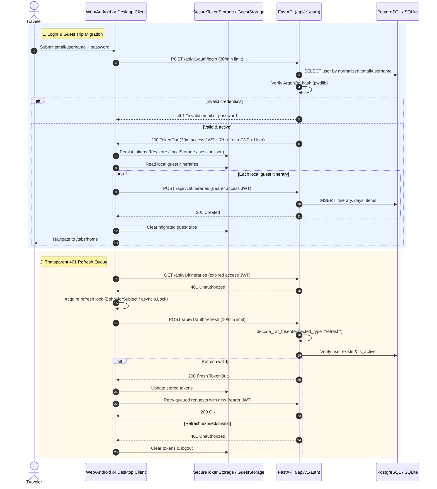

# Authentication, Token Refresh, and Guest Migration Flow

Verified sequence across `LoginPage`/`SignupPage`, `authInterceptor`, `GuestMigrationService`, `backend/app/api/v1/auth.py`, and `backend/app/services/auth_service.py`.

