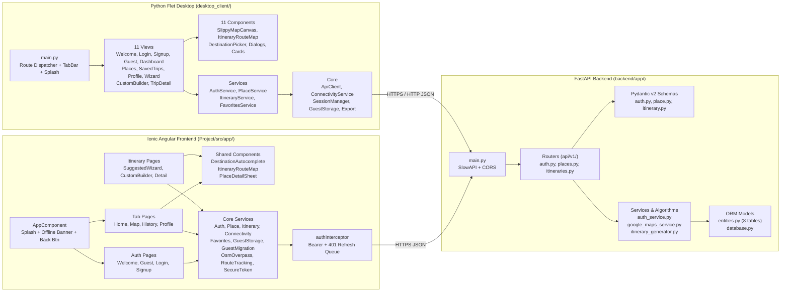

# Application Component Architecture Diagram

Internal module dependencies across the Ionic Angular Web/Android client (`Project/`), Python Flet Desktop client (`desktop_client/`), and FastAPI backend (`backend/`).

