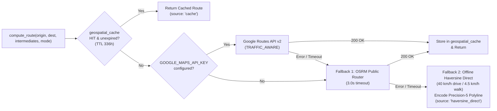

# Core Business Workflows Diagram

## 1. Deterministic Suggested Itinerary Generation (`backend/app/algorithms/itinerary_generator.py`)

```mermaid
flowchart TD
    Req["POST /api/v1/itineraries/suggest\ndestination, dates (<=14d), budget, preferences, anchor"] --> Anchor["Resolve Geographic Anchor\n1. anchor_place_id/payload\n2. Municipality match\n3. Place match\n4. Nueva Ecija center (15.58, 121.00)"]
    Anchor --> BBox["SQL Bounding-Box Pre-Filter\n(25 km radius + 10 km buffer)\n+ Haversine refinement"]
    BBox --> LiveCheck{"Local POIs sparse &\nGOOGLE_MAPS_API_KEY set?"}
    LiveCheck -->|Yes| LiveFetch["Google Places Nearby Search\n+ Upsert to places table"]
    LiveCheck -->|No| Pool["Candidate POI Pool"]
    LiveFetch --> Pool
    Pool --> DayLoop["For each travel_date (1..N)"]
    DayLoop --> SlotLoop["Score 3 Slots: Morning 09:00, Lunch 12:00, Afternoon 14:30\n- Fuzzy dedup (ID, normalized name, <200m)\n- Preference (+40/+15), Featured (+20), Bayesian Rating (+20)\n- Proximity decay, Opening Hours (-50 if closed)\n- Diversity (-25), Budget fit, Mountain/Lodging guards"]
    SlotLoop --> TSP["2-Opt TSP Permutation Ordering\nPin Day 1 Anchor first; move overnight lodging last"]
    TSP --> Pace["Dynamic Road Pacing\nCompute leg routes (Google -> OSRM -> Haversine)\nRound arrival times to 5-min increments"]
    Pace --> Assumptions["Append Transparent Assumptions\n(pacing, clustering, unverified cost count)"]
    Assumptions --> SaveCheck{"save_immediately &&\nauthenticated?"}
    SaveCheck -->|Yes| Persist["persist_generated_itinerary()\nINSERT itineraries, days, items"]
    SaveCheck -->|No| Draft["Return Editable Draft ItineraryOut"]
    Persist --> Draft
```

## 2. External Routing & Geospatial Fallback Chain (`google_maps_service.py`)

