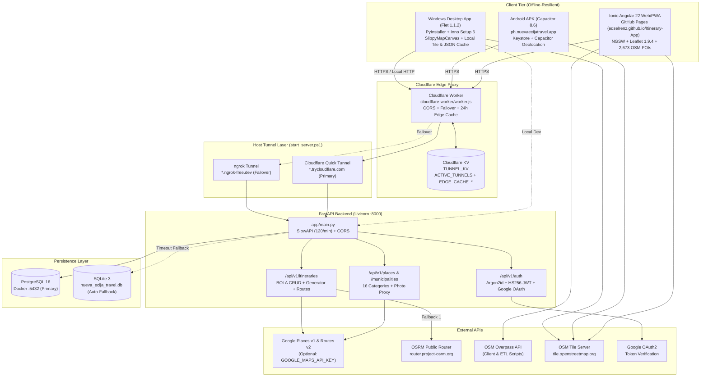

# System Architecture Diagram

This diagram illustrates the verified multi-client, edge proxy, backend, database, and external API topology of **Trip Mo, Trip Ko (Nueva Ecija Travel Itinerary App)**.

